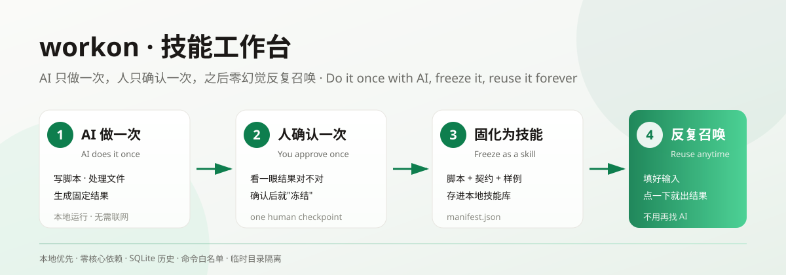
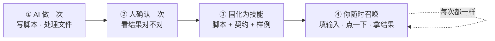
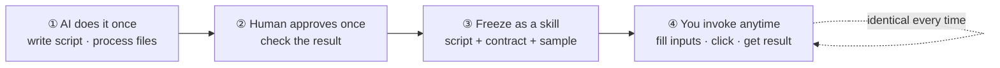

<div align="center">



# workon · 技能工作台

**AI 只做一次，人只确认一次，之后零幻觉反复召唤。**
**Do it once with AI, approve it once, then reuse it forever — zero hallucination.**

[](workon/__init__.py)
[](pyproject.toml)
[](LICENSE)
[](pyproject.toml)

[中文](#中文文档) · [English](#english)

</div>

---

<a id="中文文档"></a>

## 📖 中文文档

### 面向对象

不写代码的文员、助理、办公人员：不用你自己装环境、敲命令——把下面的话发给 AI，让它替你在电脑上装好并启动。

### 一句话说明

workon 把做好的工作**冻结**成「技能」。以后填上输入、点「召唤」，结果一模一样，**不用再找 AI，没有幻觉**。

### 上手就靠两段话（只管发话，细节交给 AI）

**第 1 次 · 装好并留住第一件事**

> 💬 **复制发给 AI：**
> ```
> 请帮我安装并开始使用开源工具 workon：如果我的电脑上还没装好，请先按项目仓库的 README 帮我装好并启动本地工作台。装好后帮我把一件要重复做的事固化成技能，固化前让我确认结果。以后我自己在网页上点「召唤」就能复现，不用再找 AI。
> 项目地址：https://github.com/joutaojian/workon
> ```

它问「确认保存成技能吗？」时回「确认」——**这是全程唯一要你做的事**。

**以后 · 每做完一件重复的事，想留住就这么说**

> 💬 **复制发给 AI：**
> ```
> 把刚刚的任务，固化成 workon 技能（开源工具，仓库：https://github.com/joutaojian/workon），请先做一份样例给我确认，我确认没问题后，再保存成技能，以后我自己在网页上点「召唤」就能复现
> ```

### 日常 · 网页点「召唤」（不再找 AI）

固化后零幻觉、零联网、零费用，每次结果一样：

1. 打开 `http://localhost:8080` →「**进入工作台**」→ 登录（默认密码 `workon`）→「**召唤技能**」；
2. 选技能、填输入（`*` 必填）→ 点「**召唤**」。文字结果在页面结果区，文件在 `data/runs/<run_id>/outputs/`。

带「⭐ 官方能力」徽章的技能（PDF 合并/拆分）是内置的，开箱即用。

---

> ## 👇 下面是给 AI / 开发者的详细文档
>
> 普通使用者读到这里就可以停了。以下内容包括实现原理、命令行、HTTP API 与项目结构。

---

### 详细文档目录

- [核心思路（30 秒看懂）](#核心思路30-秒看懂)
- [特性](#特性)
- [快速开始（命令行）](#快速开始命令行)
- [Web 控制台与 HTTP API](#web-控制台与-http-api)
- [编写与固化技能](#编写与固化技能)
- [CLI 命令速查](#cli-命令速查)
- [安全须知](#安全须知重要)
- [项目结构](#项目结构)

### 核心思路（30 秒看懂）

workon 把所有重复工作拆成 4 步，前 2 步只做一次，后 2 步可以无限重复。



**为什么这样设计？** 很多工作其实是定式：固定的输入、固定的处理、固定的输出。每次都让大模型重新理解、重新生成脚本，既慢又贵，结果还不稳定。workon 把「已经确认正确的那一次」保存下来，之后只做确定性复现——**零 token 费用、零联网、零幻觉**。

### 特性

- **一次固化，永久复用**：AI 做一次、人确认一次，脚本和契约冻结为本地技能；之后大模型退出流程。
- **确定性、零幻觉**：复现跑的是同一份已确认脚本，只换输入，不重新生成、不漂移、不花 token。
- **本地优先、零核心依赖**：只需 Python 3.9+。引擎无强制依赖，Flask 仅 Web 控制台可选需要。契约、历史、输出都留在你自己的机器上。
- **可检查的技能契约**：`manifest.json` 声明标签、输入输出（`text` / `file` / `docx` / `xlsx` / `json` / `image` / `dir`）、入口命令、参数和超时。
- **安全执行**：命令白名单、临时目录隔离、输入校验、超时控制。
- **私有脚本不进公共仓库**：真实业务脚本留在你自己的私有仓库，登记目录即可，无需复制进本仓库。
- **完整执行历史**：每次召唤的输入、参数、输出、耗时都记进本地 SQLite；结果文件保存在 `data/runs/<run_id>/outputs/`。
- **三种调用方式**：命令行、HTTP API、点网页。网页先展示首页使用方案，再密码登录进入工作台（默认 `workon`）。
- **⭐ 官方能力，开箱即用**：内置官方技能 PDF 合并/拆分（纯标准库实现，无需联网），带徽章置顶且不可删除，和用户自己添加的私有技能明确区分。

### 快速开始（命令行）

> 尚未发布到 PyPI（PyPI 上的同名 `workon` 是另一个项目），请从 GitHub 安装。Windows 终端先设中文编码：PowerShell 用 `$env:PYTHONIOENCODING = "utf-8"`，Bash 用 `export PYTHONIOENCODING=utf-8`。

```bash
# 安装
git clone https://github.com/joutaojian/workon.git
cd workon
pip install -r requirements.txt        # 仅 Flask 一个可选依赖，核心零依赖
pip install -e .                       # 可选：注册全局 workon 命令

# 说明：wheel 安装不含示例技能，示例见仓库 skills/ 目录；源码安装可用。
# 列出与召唤技能
python -m workon skill list
python -m workon tags
python -m workon skill show text-echo
python -m workon skill run text-echo --input text="hello" --param upper=true
python -m workon history --limit 10

# 文件输入 + 参数
python -m workon skill run report-builder \
  --file source="./data.xlsx" \
  --param title="九月报表"

# 登记你的私有技能目录（真实脚本放这里，不用复制进本仓库）
python -m workon skill add D:/git/my-private-skills
python -m workon skill list

# 启动网页控制台：先看到首页，浏览器打开 http://localhost:8080
python -m workon serve
# 首页点「进入工作台」→ 输入密码登录（默认 workon，可在「设置」修改）
# 可用环境变量 WORKON_PASSWORD 改默认密码，WORKON_HOST / WORKON_PORT 改监听地址
```

### Web 控制台与 HTTP API

打开 `http://localhost:8080` 先看到**首页**（介绍使用方案：AI 做一次 → 人确认一次 → 固化为技能 → 反复召唤），点「进入工作台」后需**密码登录**（默认 `workon`，页面有提示，登录后可在「设置」里修改；也可用环境变量 `WORKON_PASSWORD` 预设）。工作台提供五个页签：**使用指引**（两段话教程）、**技能库**（搜索/标签，官方能力带 ⭐ 徽章置顶且不可删除；每张技能卡可「📋 复制给 AI」，一键复制含脚本路径的话术粘贴给 AI 参考执行）、**召唤技能**（自动渲染表单）、**执行历史**、**设置**（登记外部技能目录 / 修改访问密码）。未登录访问 `/api/*` 返回 401。上传的文件和输出文件通过 HTTP 传输，输出文件以 base64 返回。

| 方法 | 路径 | 说明 |
| --- | --- | --- |
| GET | `/api/skills?q=&tag=` | 技能列表（可按关键词/标签过滤） |
| GET | `/api/skills/<id>` | 技能详情 |
| GET | `/api/tags` | 所有标签 |
| POST | `/api/skills/reload` | 重新扫描技能目录 |
| POST | `/api/skills/save` | 把含 manifest.json 的技能目录登记为内置技能 |
| POST | `/api/skills/<id>/run` | 召唤技能（JSON 或 multipart 上传） |
| GET | `/api/history?skill=&limit=` | 执行历史 |
| GET | `/api/history/<run_id>` | 单次执行详情 |
| GET / POST | `/api/settings` | 读取 / 保存设置 |
| POST | `/api/capture` | 网页端固化：扫描脚本目录生成 manifest |
| GET | `/health` | 健康检查 |

```bash
# 召唤示例
curl -X POST http://localhost:8080/api/skills/text-echo/run \
  -H "Content-Type: application/json" \
  -d '{"inputs":{"text":"hello"},"params":{"upper":true}}'
```

查询类 API 统一返回 `{"code": 0, "message": "success", "data": ...}`；召唤接口 `/api/skills/<id>/run` 直接返回执行结果（`run_id` / `status` / `outputs` / `error`）。

### 编写与固化技能

一个技能是一个目录，核心是 `manifest.json`。完整规范见 [docs/skill-format.md](docs/skill-format.md)，最小示例见 [skills/text-echo](skills/text-echo)。

```bash
# 校验 / 保存技能
python -m workon skill validate ./my-skill    # 校验（传目录，不是 manifest 文件）
python -m workon skill save ./my-skill        # 保存为内置技能（可选）

# 从 AI 做好的脚本目录固化成技能（一次）
python -m workon capture D:/work/my-job --id my-job --name "我的固定工作" \
  --tags excel,report --entry "python run.py" --yes
python -m workon skill add D:/work/my-job
python -m workon skill validate D:/work/my-job
python -m workon skill list
```

> 真实业务脚本**不要**放进内置 `skills/` 目录。用 `skill add` 或设置页登记你的私有仓库目录。固化后请勿再改脚本——复现靠同一份已确认的文件，不靠重新生成 AI。

### CLI 命令速查

`python -m workon <子命令>`，完整参数用 `--help` 查看。

| 子命令 | 说明 |
| --- | --- |
| `serve` | 启动网页控制台（首页 + 登录 + 工作台） |
| `skill list / show / validate / add / save / reload / run` | 技能登记、校验与召唤 |
| `capture` / `init` | 从 AI 脚本目录固化成技能 |
| `history` / `tags` | 执行历史与标签 |
| `install-skill` / `uninstall-skill` | 可选高级功能：把说明书装进 / 卸出 AI Agent（本项目使用不依赖它） |
| `update-check` | 只读检查引擎与说明书是否需要更新（`--offline` 断网可用） |

### 安全须知（重要）

本项目由内部工作台改造而来。当前开源仓库是从零克隆的**全新干净历史**，源码与历史中均不含任何密钥；原内部工作区的历史凭证仍须视为已泄露并**全部轮换**（数据库口令、Coze/钉钉/邮箱令牌、JWT 密钥、内网地址等，须在签发方逐一吊销重签）。

1. 不要把真实业务数据提交进公开仓库：Excel/Word 等留在你自己的私有仓库，通过 `WORKON_SKILL_DIRS` 或 `skill add` 登记即可。
2. 本项目为单机工具，Web 控制台有密码登录保护（默认密码 `workon`，**请登录后尽快修改**，也可用 `WORKON_PASSWORD` 预设），但它只是轻量防护，请勿把 `serve` 暴露到公网或不可信网络。
3. 技能执行在临时目录中进行，命令受白名单约束；但技能脚本本身拥有本机执行权限，只登记可信来源的技能目录。

### 项目结构

```
workon/                      核心包（配置/模型/注册表/执行器/存储/CLI/Web）
  config.py                  配置与环境加载
  models.py                  manifest 校验与 Skill 模型（含 official 标记）
  registry.py                技能发现与检索
  runner.py                  召唤执行器
  storage.py                 SQLite 执行历史（唯一存储）
  capture.py                 从 AI 脚本目录扫描生成 manifest（固化）
  install.py                 可选：把说明书装进各 Agent / 卸载
  update.py                  检查引擎与说明书是否需要更新
  cli.py                     命令行入口
  pages.py                   首页 / 登录页 HTML（纯 CSS，无外部资源）
  web.py                     Flask Web/API + 密码登录鉴权
  skills/workon-capture/     说明书源文件（可选功能，随包分发）
  official_skills/           ⭐ 官方能力仅 pdf-tool（PDF 合并/拆分，纯标准库，不可删除）
skills/                      内置示例技能（勿放私有脚本）
docs/                        设计与格式文档
entry.py                     开发入口（等价于 python -m workon）
AGENTS.md                    给 AI Agent 的项目地图与硬性约束（子目录各有分册）
```

---

<a id="english"></a>

## 📖 English

> [Back to 中文](#中文文档)

**Freeze one-off AI work into deterministic, local skills — invoke them again and again, without calling a model.**

### Who it is for

Non-technical office staff — you don't install anything or type commands yourself: just send the messages below to your AI and let it set up and start workon on your computer.

### In one sentence

workon **freezes** finished work into a reusable **skill**. Fill in inputs, click **Invoke** — the same result every time, **no AI, no hallucination**.

### Get started with two messages (just talk — the AI handles the rest)

**First time · Install and keep your first task**

> 💬 **Copy and send to the AI:**
> ```
> Please install and set up the open-source tool workon for me: if it is not on this machine yet, follow the project repository README to install it and start the local workbench. Then freeze one repetitive task of mine into a skill, and let me confirm the result before saving. From then on I will re-run it myself by clicking "Invoke" in the web page — no AI needed.
> Repository: https://github.com/joutaojian/workon
> ```

When it asks "Save this as a skill?", answer "yes" — **the only moment you need to do anything**.

**Later · Every time you finish a repeatable task and want to keep it**

> 💬 **Copy and send to the AI:**
> ```
> Freeze the task we just did into a workon skill (open-source tool, repo: https://github.com/joutaojian/workon). Please make a sample for me to confirm first; save it as a skill only after I confirm. From then on I will re-run it myself by clicking "Invoke" in the web page.
> ```

**Everyday · Click Invoke in the web page (no more AI)**

Zero hallucination, zero network, zero cost — identical results:

1. Open `http://localhost:8080` → **Enter Workbench** → sign in (default password `workon`) → **Invoke Skill**;
2. Pick a skill, fill inputs (`*` required) → click **Invoke**. Text shows in the result area; files are in `data/runs/<run_id>/outputs/`.

The five "⭐ Official capability" skills (PDF merge & split, word count, text tidy-up, table merge, batch rename) are built in, ready to use.

---

> ## 👇 Detailed docs for AI / developers are below
>
> Everyday users can stop here. The rest covers internals, the CLI, the HTTP API and project structure.

---

### Detailed contents

- [How it works](#how-it-works)
- [Features](#features)
- [Quick Start](#quick-start)
- [Web console and HTTP API](#web-console-and-http-api)
- [Writing and freezing skills](#writing-and-freezing-skills)
- [CLI command reference](#cli-command-reference)
- [Security](#security)
- [Project structure](#project-structure)

### How it works

workon splits every repeated job into 4 steps — the first two happen once, the last two repeat indefinitely.



Most work is a fixed pattern: fixed inputs, fixed processing, fixed outputs. Asking a model to re-interpret and re-generate the script each time is slow, costly and unstable. workon saves "the one confirmed-correct run" and only reproduces it deterministically — **zero token cost, zero network, zero hallucination**.

### Features

- **Freeze once, reuse forever** — AI does it once, a human approves once, and the script plus contract are frozen as a local skill. The model then leaves the loop.
- **Deterministic, zero-hallucination results** — re-runs execute the same confirmed script with new inputs only: no regeneration, no drift, no token cost.
- **Local-first, zero core dependencies** — only Python 3.9+ is required; Flask is optional for the Web console. Contracts, history and outputs stay on your machine.
- **Inspectable skill contracts** — `manifest.json` declares tags, inputs/outputs (`text` / `file` / `docx` / `xlsx` / `json` / `image` / `dir`), entry command, parameters and timeout.
- **Safe by design** — command allowlist, isolated temporary directories, input validation and timeouts.
- **Private scripts stay private** — keep real business scripts in your own private repository and just register the directory.
- **Complete execution history** — every run's inputs, parameters, outputs and duration go into local SQLite; output files persist under `data/runs/<run_id>/outputs/`.
- **Three ways to invoke** — CLI, HTTP API, or a point-and-click Web console. The web app first shows a home page explaining the workflow, then asks for a password to enter the workbench (default `workon`).
- **⭐ Official capabilities, ready to use** — five built-in official skills: PDF merge & split, word count, text tidy-up, table merge, batch rename (pure standard library, no network needed), badged, pinned to the top and non-deletable — clearly distinct from skills you add yourself.

### Quick Start

> Not published on PyPI (the `workon` there is a different project). Install from GitHub. Windows: set encoding first — PowerShell `$env:PYTHONIOENCODING = "utf-8"`, Bash `export PYTHONIOENCODING=utf-8`.

```bash
git clone https://github.com/joutaojian/workon.git
cd workon
pip install -r requirements.txt      # optional: Flask, only for the Web console
pip install -e .                     # optional: register the global `workon` command

# Note: the wheel does not bundle the example skills; see the repository skills/ directory. Source installs include them.
python -m workon skill list
python -m workon tags
python -m workon skill show text-echo
python -m workon skill run text-echo --input text="hello" --param upper=true
python -m workon history --limit 10

python -m workon skill run report-builder \
  --file source="./data.xlsx" \
  --param title="September Report"

python -m workon skill add D:/git/my-private-skills   # register your private scripts
python -m workon serve                               # Home page at http://localhost:8080, then sign in
# Default password workon; set WORKON_PASSWORD to change it, or change it in Settings after login
```

### Web console and HTTP API

Open `http://localhost:8080` — you first see the **home page** (the workflow: AI does it once → human approves → freeze as a skill → invoke repeatedly), then click **Enter Workbench** to **sign in with a password** (default `workon`, hinted on the page; change it in **Settings** or preset via `WORKON_PASSWORD`). The workbench has five tabs: **Guide** (the two-message tutorial), **Skill library** (search/tags; official capabilities carry a ⭐ badge, pinned and non-deletable; each skill card has "📋 Copy for AI" to copy a prompt with the script path for another AI to reference), **Invoke Skill** (auto-rendered form), **Execution history**, and **Settings** (register skill directories / change the access password). Unauthenticated `/api/*` requests return 401. Uploaded and output files travel over HTTP; outputs are returned as base64.

| Method | Path | Description |
| --- | --- | --- |
| GET | `/api/skills?q=&tag=` | List skills (filter by keyword/tag) |
| GET | `/api/skills/<id>` | Skill detail |
| GET | `/api/tags` | All tags |
| POST | `/api/skills/reload` | Rescan skill directories |
| POST | `/api/skills/save` | Register a manifest-containing directory as a built-in skill |
| POST | `/api/skills/<id>/run` | Invoke a skill (JSON or multipart upload) |
| GET | `/api/history?skill=&limit=` | Execution history |
| GET | `/api/history/<run_id>` | Single run detail |
| GET / POST | `/api/settings` | Read / save settings |
| POST | `/api/capture` | Web-side freeze: scan a script directory to build a manifest |
| GET | `/health` | Health check |

```bash
curl -X POST http://localhost:8080/api/skills/text-echo/run \
  -H "Content-Type: application/json" \
  -d '{"inputs":{"text":"hello"},"params":{"upper":true}}'
```

All `/api/*` endpoints except `/health` require a password sign-in first (submit `POST /login` with `password=workon` and keep the session cookie); unauthenticated requests get HTTP 401. Query APIs return `{"code": 0, "message": "success", "data": ...}`; the invoke endpoint `/api/skills/<id>/run` returns the raw result (`run_id` / `status` / `outputs` / `error`).

### Writing and freezing skills

A skill is a directory whose core is `manifest.json`. See [docs/skill-format.md](docs/skill-format.md) for the full spec and [skills/text-echo](skills/text-echo) for a minimal example.

```bash
python -m workon skill validate ./my-skill    # pass the directory, not the manifest file
python -m workon skill save ./my-skill        # optional: save as a built-in skill

# Freeze an AI-built script directory into a skill (once)
python -m workon capture D:/work/my-job --id my-job --name "My Fixed Job" \
  --tags excel,report --entry "python run.py" --yes
python -m workon skill add D:/work/my-job
python -m workon skill validate D:/work/my-job
python -m workon skill list
```

> Do not put real business scripts in the built-in `skills/` directory. Use `skill add` or the Web settings page to register your private repository. After freezing, do not modify the script — reproduction relies on the same confirmed file, not on regenerating AI output.

### CLI command reference

`python -m workon <subcommand>`; use `--help` for full arguments.

| Subcommand | Description |
| --- | --- |
| `serve` | Start the Web console (home + login + workbench) |
| `skill list / show / validate / add / save / reload / run` | Register, validate and invoke skills |
| `capture` / `init` | Freeze an AI-built script directory into a skill |
| `history` / `tags` | Execution history and tags |
| `install-skill` / `uninstall-skill` | Optional advanced feature: install/remove the instruction file in AI agents (not required to use workon) |
| `update-check` | Read-only check for engine / instruction updates (`--offline` works offline) |

### Security

This project was converted from an internal workspace. The open-source repository was cloned from scratch with a **clean history** containing no secrets; historical credentials from the old internal workspace must nevertheless be treated as compromised and **rotated** (database passwords, Coze/DingTalk/email tokens, JWT secrets, internal addresses — revoke and reissue at each issuer).

1. Do not commit real business data to a public repository. Keep Excel/Word files in your own private repository and register the directory via `WORKON_SKILL_DIRS` or `skill add`.
2. workon is a single-machine tool and the Web console has password sign-in (default password `workon` — change it promptly after login, or preset via `WORKON_PASSWORD`) — this is lightweight protection only, so do not expose `serve` to the public internet or untrusted networks.
3. Skills run in temporary directories under a command allowlist, but skill scripts have local execution privileges — only register skill directories from trusted sources.

### Project structure

```
workon/                       core package (config / models / registry / runner / storage / CLI / Web)
  config.py                   configuration and environment loading
  models.py                   skill contract validation and Skill model (incl. official flag)
  registry.py                 skill discovery and lookup
  runner.py                   invocation engine
  storage.py                  SQLite execution history (the only storage)
  capture.py                  scan an AI script directory to build a manifest (freeze)
  install.py                  optional: install/uninstall the instruction file in AI agents
  update.py                   check engine / instruction versions
  cli.py                      command-line entry point
  pages.py                    home / login page HTML (pure CSS, no external assets)
  web.py                      Flask Web console, HTTP API and password sign-in
  skills/workon-capture/      instruction file source (optional feature, shipped with the package)
  official_skills/            ⭐ only pdf-tool (PDF merge/split, pure stdlib, non-deletable)
skills/                       built-in example skills (do not put private scripts here)
docs/                         design and skill-format documentation
entry.py                      development entry point (equivalent to python -m workon)
AGENTS.md                     project map and hard constraints for AI agents (per-directory addenda)
```

---

<div align="center">

## License

[MIT](LICENSE)

workon · 让 AI 做一次，之后稳稳复现 · Freeze it once, reproduce it forever.

</div>
